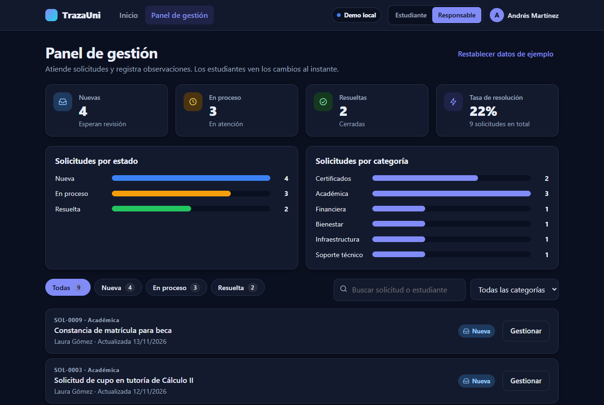

# TrazaUni · Sistema de trazabilidad de solicitudes

> Prototipo web inicial del proyecto de Ingeniería Web (ABP). Permite que un estudiante radique solicitudes y siga su estado —**Nueva → En proceso → Resuelta**— en tiempo real, mientras un responsable las gestiona y deja observaciones que quedan registradas como historial.



## 1. Descripción del proyecto

En muchas instituciones, el estudiante radica una petición (certificado, reclamo, soporte…) y no vuelve a saber de ella hasta que alguien le responde. **TrazaUni** hace visible todo el recorrido: cada solicitud tiene un código (`SOL-0001`), un estado, una línea de tiempo con las observaciones de quien la atiende y se actualiza en la pantalla del estudiante **sin recargar la página**.

Hay dos perfiles:

| Perfil | Qué puede hacer |
|---|---|
| **Estudiante** | Radicar solicitudes, ver únicamente las suyas, filtrarlas por estado, consultar su historial de seguimiento y recibir avisos en vivo. |
| **Responsable** | Ver todas las solicitudes con indicadores y gráficas, buscarlas y filtrarlas, cambiar su estado y registrar observaciones. |

## 2. Objetivo general

Desarrollar un sistema web de trazabilidad de solicitudes que muestre al estudiante, en tiempo real, el estado y el historial de observaciones de cada una de sus solicitudes, y que ofrezca a los responsables un panel para gestionarlas.

## 3. Alcance inicial (esta entrega)

**Incluido en el prototipo**

- Interfaz responsive (computador, tableta y móvil) con modo claro y oscuro automático.
- Landing con indicadores en vivo, vista de estudiante y panel de responsable, con navegación funcional entre perfiles.
- Radicación de solicitudes con validación de formulario.
- Gestión del estado con observaciones; reglas de negocio: el estado solo avanza, la observación es obligatoria y una solicitud resuelta se cierra.
- Línea de tiempo (trazabilidad), barra de progreso de 3 pasos, avisos en vivo, filtros, búsqueda y gráficas.
- **Datos simulados**: el prototipo funciona solo con el frontend (modo demo local).
- Backend Express + WebSockets con la misma lógica, y esquema Prisma/PostgreSQL ya modelado.

**Fuera de alcance por ahora** (siguientes entregas): conexión real a PostgreSQL con Prisma, autenticación (el perfil se elige con un selector), notificaciones por correo y adjuntos.

## 4. Tecnologías utilizadas

| Capa | Tecnología | Por qué |
|---|---|---|
| Frontend | **Next.js 16** (App Router) + **React 19**, HTML5, CSS3 y JavaScript | Navegación clara entre perfiles y base para las siguientes entregas. |
| Estilos | CSS3 propio (variables, Grid, Flexbox, `prefers-color-scheme`) | Sin dependencias; control total del diseño responsive y la accesibilidad. |
| Backend | **Node.js + Express 5** + **ws** (WebSockets) | Emite los cambios de estado a todos los clientes conectados. |
| Base de datos | **PostgreSQL + Prisma ORM** (esquema listo) | Modelo relacional de usuarios, solicitudes e historial de observaciones. |
| Herramientas | Visual Studio Code, Git y GitHub | |

## 5. Cómo ejecutar el prototipo

Requisitos: **Node.js 20 o superior** y npm.

### Opción A — Demo rápida (solo frontend, datos simulados)

```bash
cd frontend
npm install
npm run dev
```

Abre <http://localhost:3000>. Los datos viven en el navegador (`localStorage`) y los cambios se reflejan al instante **entre pestañas**.

> **Cómo probar el tiempo real:** abre la app en dos pestañas. En la primera entra como *Estudiante* (`/estudiante`); en la segunda, como *Responsable* (`/admin`, con el selector de perfil de la barra superior). Cambia el estado de una solicitud en el panel y mira cómo aparece en la otra pestaña sin recargar. Usa **Restablecer datos de ejemplo** en el panel para volver al estado inicial.

### Opción B — Sistema completo (frontend + backend con WebSockets)

```bash
# 1) Backend (puerto 4000)
cd backend
npm install
npm start

# 2) Frontend (puerto 3000), en otra terminal
cd frontend
npm install
# Windows PowerShell:  $env:NEXT_PUBLIC_API_URL="http://localhost:4000"; npm run dev
# macOS / Linux:       NEXT_PUBLIC_API_URL=http://localhost:4000 npm run dev
```

Con el backend activo, el indicador de la barra superior cambia de **Demo local** a **En vivo**, y las actualizaciones viajan por WebSocket entre equipos distintos.

### Pruebas del backend

```bash
cd backend
npm test
```

### Estructura del repositorio

```
.
├── frontend/                 Next.js (interfaz)
│   ├── app/                  Páginas: / · /estudiante · /admin
│   ├── components/           Componentes reutilizables (tarjetas, timeline, formulario, drawer…)
│   └── lib/
│       ├── domain.js         Reglas de negocio puras (estados, validaciones)
│       ├── seed.js           Datos simulados
│       ├── store.js          Estado global + modo local / modo servidor (WebSocket)
│       └── format.js         Formato de fechas
├── backend/                  Express + WebSockets
│   ├── src/server.js         API REST + servidor WS
│   ├── src/domain.js         Copia de frontend/lib/domain.js (mantener sincronizada)
│   ├── src/seed.js           Copia de frontend/lib/seed.js (mantener sincronizada)
│   └── prisma/schema.prisma  Modelo de datos (PostgreSQL)
├── docs/evidencias/          Capturas del prototipo funcionando
├── docker-compose.yml        PostgreSQL local para la fase 2
└── README.md
```

## 6. Arquitectura y tiempo real

```
 Estudiante (navegador) ──┐                          ┌── Responsable (navegador)
                          │   REST: POST / PATCH     │
                          ├────────────────────────► Express ◄───────────────────┤
                          │                          │   (valida y guarda)       │
                          │◄──── WebSocket /ws ──────┘◄──── WebSocket /ws ───────┘
                              snapshot · request:created · request:updated
```

- Las **mutaciones** (radicar, cambiar estado) son peticiones REST validadas en el servidor.
- Cada cambio exitoso se **emite por WebSocket** a todos los clientes conectados; el cliente actualiza su estado, resalta la tarjeta modificada y muestra un aviso.
- Al conectarse, el cliente recibe un `snapshot` con el estado actual; si la conexión se cae, **reconecta automáticamente**.
- El control de acceso es **simulado** en esta fase (el servidor exige `role: ADMIN` para cambiar estados); la autenticación real llegará en una entrega posterior.

### Modelo de datos (Prisma)

`User` (estudiante o responsable) 1—N `TraceRequest` (solicitud con estado `NUEVA | EN_PROCESO | RESUELTA`) 1—N `Observation` (historial: quién, cuándo, qué estado y qué observación). Ver [`backend/prisma/schema.prisma`](backend/prisma/schema.prisma).

## 7. Evidencias de funcionamiento

El prototipo se ejecutó en un navegador actualizado (Microsoft Edge) y se verificó en tres tamaños de pantalla. Todas las capturas están en [`docs/evidencias/`](docs/evidencias/).

| Vista | Computador | Tableta | Móvil |
|---|---|---|---|
| Inicio | [ver](docs/evidencias/01-inicio-desktop.png) | [ver](docs/evidencias/01-inicio-tablet.png) | [ver](docs/evidencias/01-inicio-movil.png) |
| Estudiante | [ver](docs/evidencias/02-vista-estudiante-desktop.png) | [ver](docs/evidencias/02-vista-estudiante-tablet.png) | [ver](docs/evidencias/02-vista-estudiante-movil.png) |
| Responsable | [ver](docs/evidencias/03-panel-responsable-desktop.png) | [ver](docs/evidencias/03-panel-responsable-tablet.png) | [ver](docs/evidencias/03-panel-responsable-movil.png) |

Otras capturas: [gestión de una solicitud](docs/evidencias/04-gestionar-solicitud-desktop.png) · [menú móvil](docs/evidencias/05-menu-movil.png) · [modo claro](docs/evidencias/06-inicio-modo-claro.png) · [seguimiento en modo claro](docs/evidencias/08-seguimiento-modo-claro.png) · [**tiempo real por WebSocket**](docs/evidencias/09-tiempo-real-websocket.png).

**Comprobaciones realizadas**

- Formulario: valida campos vacíos y radica correctamente.
- Navegación entre inicio, estudiante y responsable; menú hamburguesa en móvil.
- Filtros por estado y búsqueda por texto en el panel.
- Cambio de estado con observación (rechaza observaciones muy cortas y retrocesos de estado).
- Tiempo real verificado en los dos modos: entre pestañas (modo local) y entre dos navegadores independientes a través del backend (WebSocket).
- Sin scroll horizontal a 390 px de ancho y sin errores de JavaScript en consola.
- Backend: 3 pruebas automatizadas (`npm test`) sobre REST, reglas de negocio y emisión por WebSocket.

## 8. Próximos pasos

1. Conectar el backend a PostgreSQL con Prisma (`docker compose up -d` + `npm run db:migrate`).
2. Autenticación y autorización reales por perfil.
3. Notificaciones por correo y adjuntos en las solicitudes.
4. Pruebas automatizadas del frontend y despliegue.

## Integrantes

- _Nombre completo del integrante 1_
- _Nombre completo del integrante 2_
